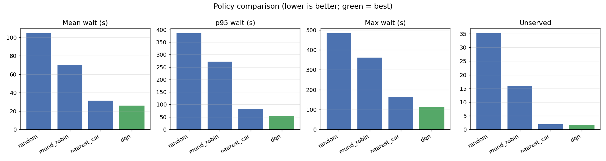
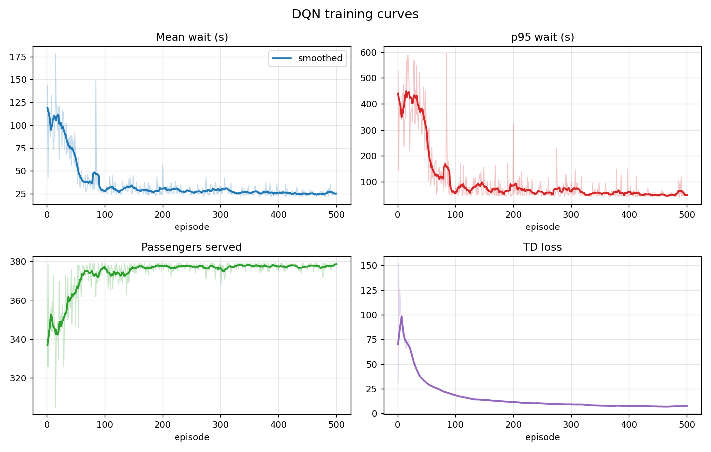
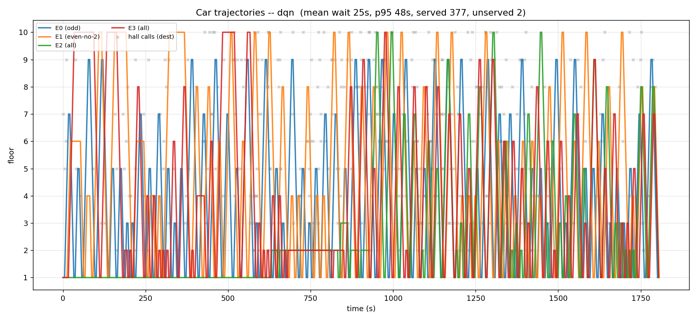

# elevator-dispatch-rl

**A DQN that dispatches four elevators in a simulated 10-floor building during a morning rush, compared with a nearest-car heuristic** (capstone project).
The simulator is a small event-driven Python environment with a Gymnasium-style API. Lobby arrivals are generated from six 5-minute passenger counts (08:40–09:10, 379 passengers in total). Every time a passenger arrives, the agent picks the elevator that will serve them. The trained DQN is compared with nearest-car, round-robin and random dispatching on the same 20 arrival seeds.



## What is implemented

| Component | File | Notes |
|---|---|---|
| Simulator | `elevator_env.py` | 10 floors, 4 cars with floor restrictions, capacity 15, event-driven: one decision per arriving passenger |
| Action masking | `elevator_env.py`, `dqn_agent.py` | `action_mask()` marks cars that can reach the passenger's floor; masked Q-values are set to `-inf` when acting and in the Bellman target |
| Baselines | `heuristic.py` | Nearest-car (NCA) score, round-robin, uniform random (all respect the floor restrictions) |
| DQN | `dqn_agent.py` | MLP Q-network; **Double DQN**, **dueling head** and **prioritized replay**, each with an on/off flag |
| Training | `train.py` | ε-greedy training loop, per-episode CSV log |
| Evaluation | `evaluate.py` | Greedy rollouts on seeds 0–19, mean / p95 / max wait, served / unserved |
| Plots | `visualize.py` | Learning curves, comparison bars, time-vs-floor car trajectories (PNG/GIF) |

## Simulator

| Property | Value |
|---|---|
| Floors | 1–10, all passengers board at floor 1 (up-peak only) |
| Elevators | E0: odd floors `{1,3,5,7,9}` · E1: `{1,4,6,8,10}` · E2, E3: all floors |
| Capacity | 15 passengers per car |
| Timing | 2 s per floor, 4 s per stop for doors and boarding |
| Episode | 1800 s (30 min) |
| Arrivals | Fixed counts per 5-min bucket `[36, 56, 75, 105, 73, 34]`, arrival times uniform within each bucket |
| Destinations | Uniform over floors 2–10 |

Only the six bucket counts come from the morning-rush observation. They are hard-coded in `elevator_env.py`, and the raw observation data is not in this repo. Destinations and timings are assumptions.

## MDP

**Decision.** `Discrete(4)`: which car serves the passenger who just arrived. Decisions are event-driven (one per passenger, so about 379 per episode), not one per simulator tick.

**Observation (34-dim).**

* Per car (×4): floor / 10, load / 15, queued stops / 10, seconds until free / 60, and whether the car can reach the current passenger's destination
* Current call: destination / 10, origin / 10
* Waiting passengers counted by destination floor (/ 10)
* `sin` / `cos` of the episode phase

**Reward.** Between two decisions at `t0 < t1`:

```
r = −Σ_passengers  (seconds spent waiting inside [t0, t1])
```

Summed over an episode, this is the total waiting time of all passengers. At the end of the episode, each passenger who is still waiting is charged their full wait (`1800 − arrival_time`) once more as an extra penalty. If a masked action ever reaches the environment, it is replaced by the feasible car with the shortest queue and the reward gets −5. With masking on, this never happened during training (the `invalid` column of `train_log.csv` is always 0).

**Agent** (`train.py` defaults). The network is a 2 × 128 ReLU MLP trained with Huber loss and Adam (lr 1e-3), with gradients clipped at norm 10 and γ = 0.99. Replay holds 50k transitions with batch size 64, and the target network is synced every 500 updates. ε decays linearly from 1.0 to 0.05 over 15k updates. Prioritized replay uses α = 0.6, with β annealed from 0.4 to 1.0.

## Results

Greedy policies, averaged over evaluation seeds 0–19 (served + unserved = 379 per episode) (`compare.csv`, `compare_vanilla.csv`):

| Policy | Mean wait | p95 wait | Max wait | Served | Unserved |
|---|---|---|---|---|---|
| random | 104.7 s | 386.0 s | 484.5 s | 343.75 | 35.25 |
| round-robin | 70.0 s | 271.8 s | 361.2 s | 363.00 | 16.00 |
| nearest-car (NCA) | 31.4 s | 83.3 s | 163.3 s | 377.05 | 1.95 |
| DQN, vanilla (`dqn_vanilla.pt`) | 28.3 s | 70.1 s | 160.3 s | 377.05 | 1.95 |
| DQN, Double + Dueling + PER, 500 episodes (`dqn.pt`) | **25.7 s** | **53.7 s** | **112.3 s** | 377.55 | 1.45 |

"Wait" is the time from arrival to boarding. Ride time is not counted. A passenger still waiting at 1800 s counts as unserved, and their wait is cut off at the end of the episode. The vanilla checkpoint was trained with `--no-double --no-dueling --no-prioritized`, but its training log was not kept, so its episode count is not recorded.

The 500-episode training run of `dqn.pt` (`train_log.csv`, ε-greedy, so slightly noisier than greedy evaluation):



Car trajectories of `dqn.pt` on seed 0 (grey crosses mark passengers' destinations at their arrival times):



## What I learned

1. **The reward can be the metric itself.** Charging the agent for every second every passenger spends waiting makes the episode return equal to minus the total waiting time (plus the end-of-episode charge for unserved passengers). That left only one extra penalty to reason about, instead of a set of shaping terms. The decision is also event-driven, so an episode is only about 379 steps long instead of 1800 ticks.
2. **Hard constraints belong in the action mask, not the reward.** Two cars cannot reach some floors. Masking those cars both when acting and in the target `max` meant the agent never picked an unreachable car in 500 training episodes. The −5 penalty exists only as a fallback.
3. **A simple heuristic is a strong baseline.** Random and round-robin are far behind, but nearest-car is only about 6 s worse than the DQN on mean wait. Most of the measured gap is in the tail (p95 and max wait). Those averages hide a lot of seed-to-seed variation, so I would not claim the DQN is better on every arrival sequence.

## Limitations / next steps

* **One training run** (training seed 0) per configuration, and the evaluation table reports means only, with no spread or confidence intervals. The difference between the vanilla and enhanced DQN is therefore not a controlled ablation.
* **Same traffic for training and evaluation.** Both use the same arrival profile, so robustness to other days or traffic patterns is untested.
* **Simplified building.** The simulator models up-peak traffic from the lobby only, with uniform destinations. Each car visits its queued stops in FIFO order, with no SCAN/collective control and no acceleration model, and every stop takes a fixed 4 s however many people board. A passenger who does not fit into a full car stays assigned to that car until it is next sent to the lobby.
* **Heuristic baseline.** The NCA score in `heuristic.py` is a simple hand-weighted rule (queue and load penalties), not a tuned commercial group-control algorithm.
* **No policy analysis** beyond the trajectory plot. I have not measured *what* the DQN does differently from NCA (for example, how it uses the two all-floor cars).
* Next steps: repeat training over several seeds and report confidence intervals, randomize the arrival profile and timings, and try a per-car multi-agent formulation.

## Run

Tested with Python 3.12, torch 2.9 (CPU), gymnasium 1.3, numpy 2.4 and matplotlib 3.10.

```bash
pip install -r requirements.txt

# evaluate the included checkpoints against the baselines (seconds on CPU)
python evaluate.py --ckpt dqn.pt --episodes 20 --csv compare.csv
python evaluate.py --ckpt dqn_vanilla.pt --episodes 20 --csv compare_vanilla.csv

# train from scratch (Double + Dueling + PER by default)
python train.py --episodes 500 --out dqn.pt --log-csv train_log.csv
python train.py --episodes 500 --no-double --no-dueling --no-prioritized --out dqn_vanilla.pt --log-csv train_vanilla.csv

# figures
python visualize.py curve      --csv train_log.csv --out curve.png
python visualize.py compare    --csv compare.csv   --out compare.png
python visualize.py trajectory --ckpt dqn.pt --seed 0 --out trajectory.png   # add --gif trajectory.gif for an animation
```

`--device auto` (the default) uses CUDA if a CUDA build of torch is installed. The network is small, so CPU is fine.
